# Capturas de tela (Sys-Inspector v1.4.1)

Telas do painel do servidor no laboratório em 10/10/2026: servidor na `openSUSE`
(192.168.56.161) e três agentes (`openSUSE`, `gwlocal` e `sles15efiboot1`), em
modo ocioso. O texto de cada tooltip, balão de ajuda e ação clicável está em
[GUIA-elementos.md](GUIA-elementos.md), porque tooltip não aparece em captura de
tela.

As capturas de agosto (v1.0.0) foram substituídas: mostravam "Frota" e "Laudo",
nomes que a interface deixou na 1.4.0.

## 1. Hosts

Tela inicial (Manager): um host por linha, com severidade da última captura,
presença e ritmo do agente, e as ações.

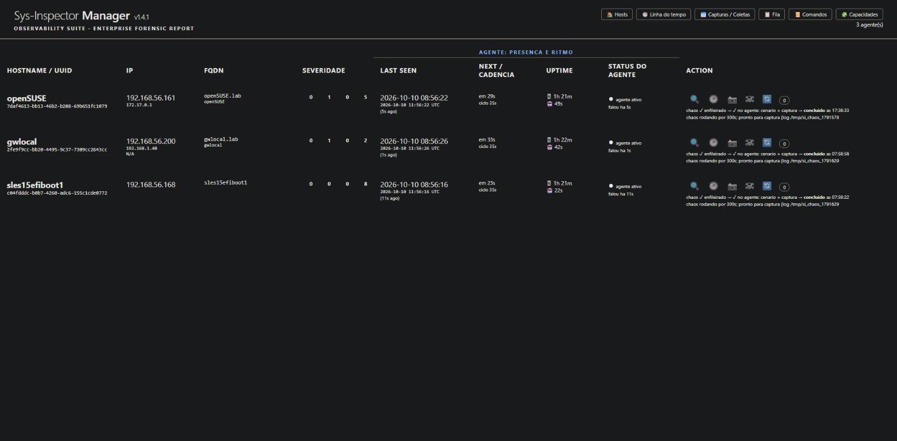

## 2. Linha do tempo

Calendário de achados e descobertas de todos os hosts. Cada dia mostra a faixa de
severidade dos achados distintos, os achados novos e o total de eventos.

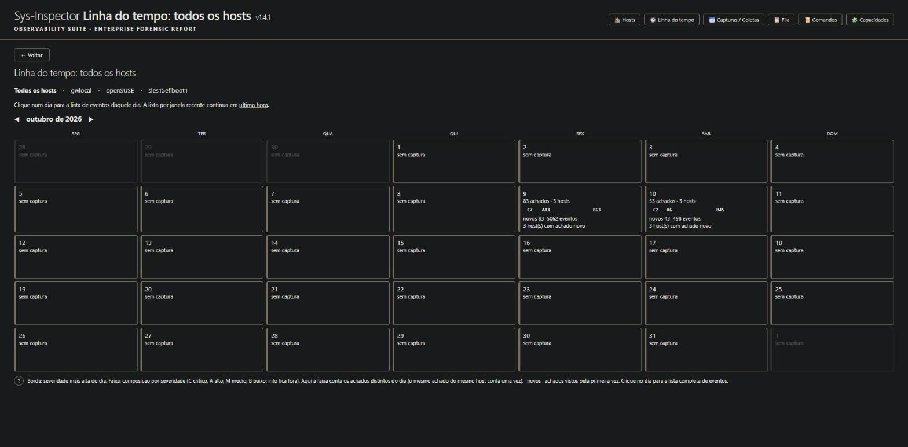

Lista de um dia: faixa das 24 horas, filtros por janela e por tipo de evento, a
leitura da sequência (correlação) e os eventos em ordem cronológica. A hora sem
evento diz "sem evento", e o processo sem sinal de risco diz "nada encontrado".

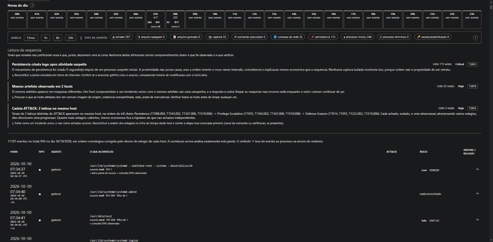

O mesmo dia, dentro de um host: o título diz o host e o dia, e o corte da lista é
avisado.

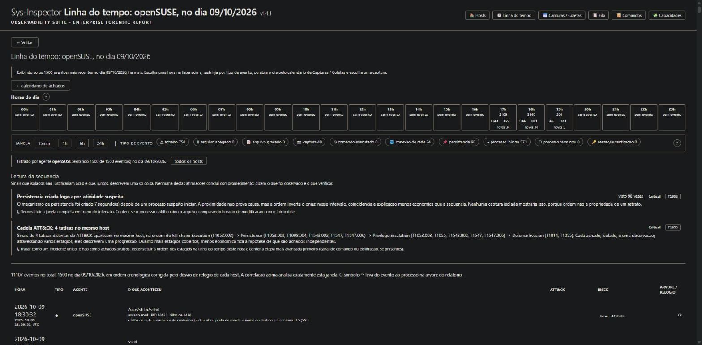

## 3. Capturas / Coletas

Calendário de capturas de todos os hosts: quantas capturas, a faixa da pior
captura do dia e as marcas (mudaram, fora do padrão, lacunas).

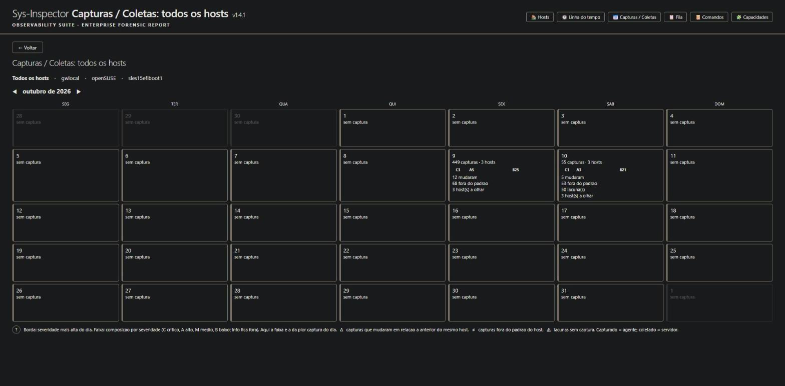

Dia selecionado, com a faixa das 24 horas abaixo do mês. A hora sem captura diz
"sem captura".

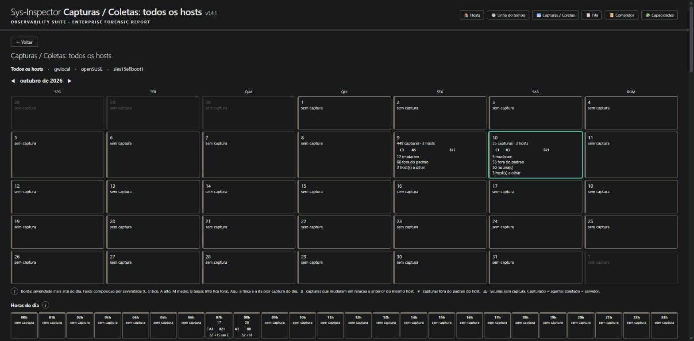

Lista do dia por host: horário capturado (agente) e coletado (servidor), atraso
da coleta, tipo, achados e marcas com o detalhe de cada uma. Capturas iguais em
sequência viram um grupo, com "primeira" e "ultima".

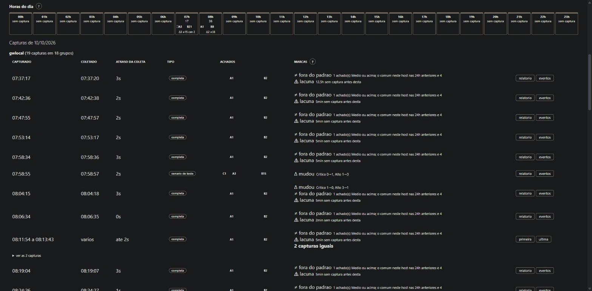

## 4. Fila de ingestão

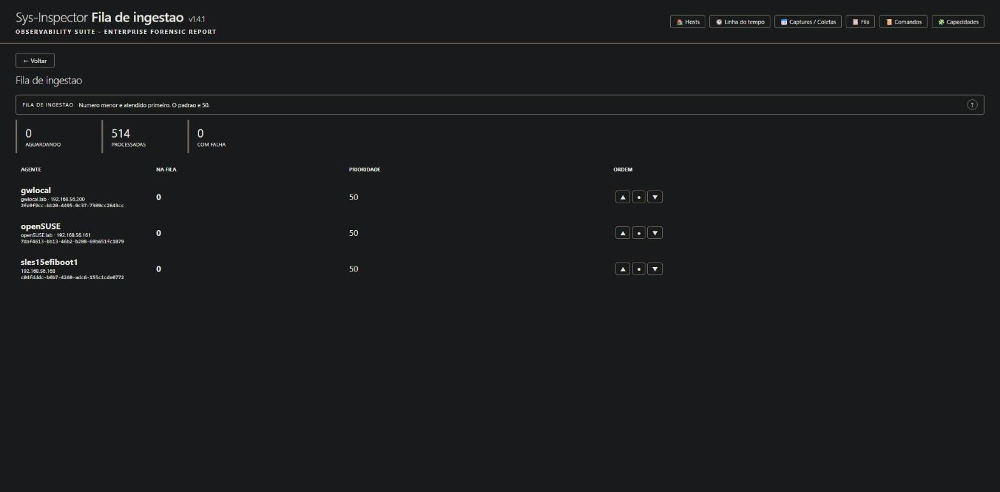

## 5. Registro de comandos

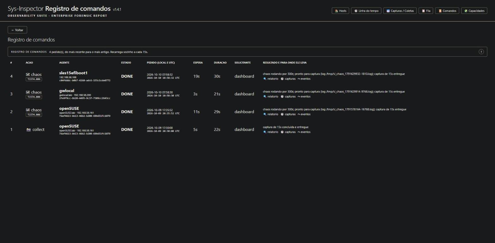

## 6. Capacidades dos hosts

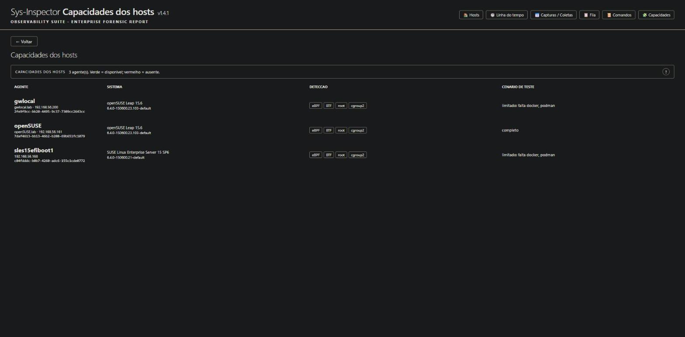

## 7. Relatório do agente

Aba Findings: barra de navegação entre capturas (com o tipo da captura e os botões
Linha do tempo e Capturas / Coletas do host), inventário e achados por prioridade.

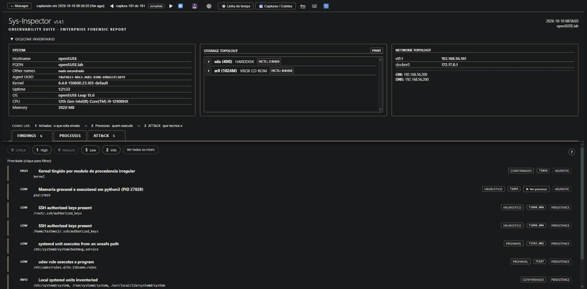

Achado de kernel tingido aberto: os módulos que carregam a marca, com horário de
carga, arquivo conferido contra a memória, sha256, pacote e assinante.

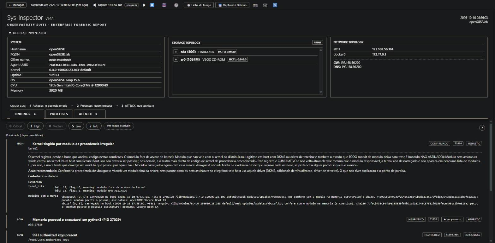

Achado com o bloco "Encaminhamento para analise": o que a ferramenta não conclui,
por quê, e sobre qual objeto.

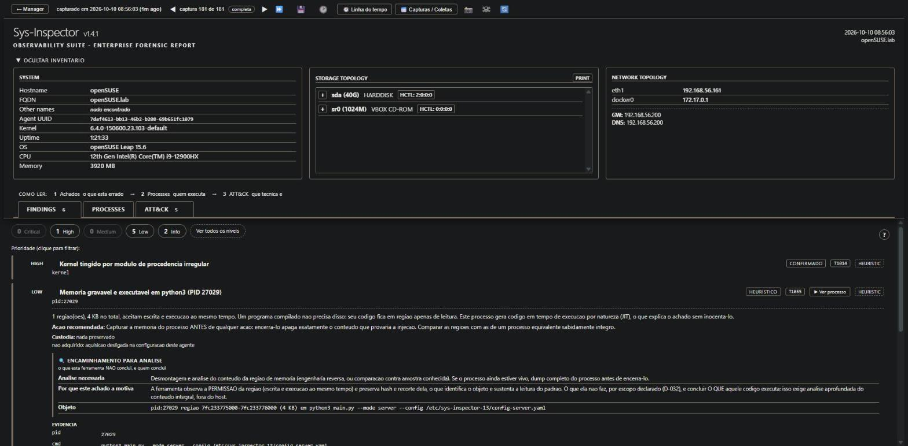

Aba Processes, com o inventário recolhido e a árvore aberta.

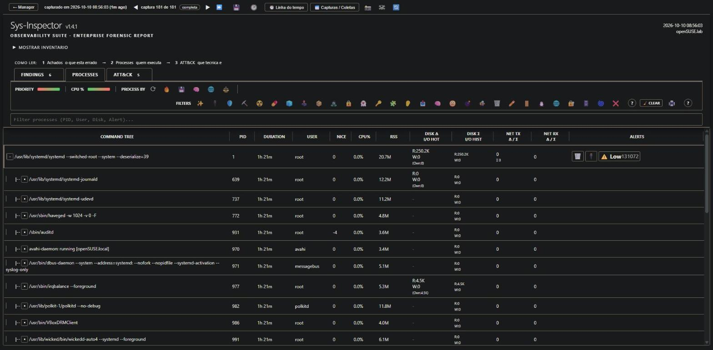

Detalhe de um processo.

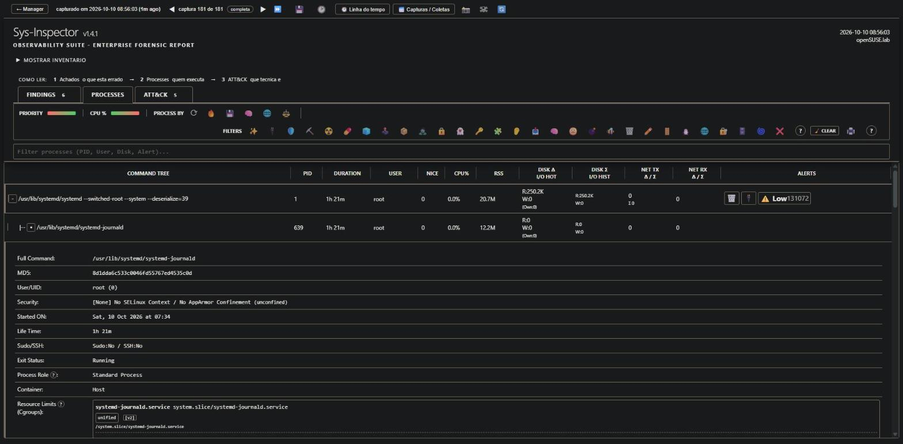

Aba ATT&CK: as técnicas citadas pelos achados, na ordem do kill chain.

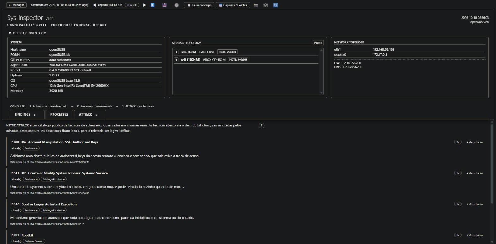

## 8. Histórico do agente

Comportamento ao longo das capturas recentes e a lista de capturas para comparar
ou baixar.

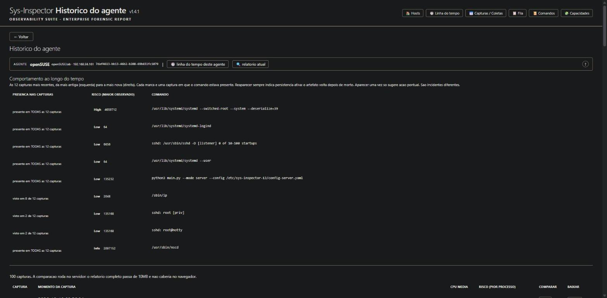

## Como reproduzir

As capturas foram feitas no Chrome, janela de 1600 por 1000, a partir do painel
`https://192.168.56.161:8443/`. O guia de elementos foi extraído das mesmas
páginas por um script que lê o HTML servido e reúne os atributos `title`, os
balões `.balao` e `.score-tooltip` e os manipuladores `onclick`, agrupando valores
que mudam a cada captura.
